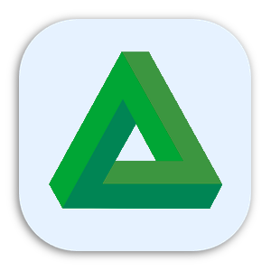

<p align="center">
  
</p>

<h1 align="center">Local LLM</h1>

<p align="center">
  <b>Run language models on your phone. Offline, private, no cloud.</b><br/>
  An Android app powered by <a href="https://github.com/ggml-org/llama.cpp">llama.cpp</a>, with GGUF models from
  <a href="https://huggingface.co/">Hugging Face</a>, that also talks to your LM Studio, Ollama and llama-server.
</p>

<p align="center">
  <a href="https://github.com/Leo00703/Local-LLM/releases/latest"></a>
  <a href="https://github.com/Leo00703/Local-LLM/actions/workflows/build-debug-apk.yml"></a>
  <a href="LICENSE"></a>
  
  
  
</p>

<p align="center">
  <a href="#download">Download</a> ·
  <a href="#features">Features</a> ·
  <a href="#additions-in-this-fork">What's new in this fork</a> ·
  <a href="#supported-models">Models</a> ·
  <a href="#build-from-source">Build</a> ·
  <a href="CONTRIBUTING.md">Contribute</a>
</p>

<p align="center">
  
</p>

> **Personal fork of [andriydruk/LMPlayground](https://github.com/andriydruk/LMPlayground)**, with extra features
> layered on top of the original app. Full credit for the original goes to
> [Andriy Druk](https://github.com/andriydruk); like upstream, this fork is MIT-licensed.

## Download

**[Get the latest APK from Releases](https://github.com/Leo00703/Local-LLM/releases/latest)**, then open it on your phone
and allow installs from your browser or file manager.

| File | Use it for |
|------|-----------|
| `local-llm-<version>-arm64-v8a-sideload.apk` | Daily use: smaller and smoother (R8-shrunk, not debuggable). |
| `local-llm-<version>-arm64-v8a-debug.apk` | Fallback, and the one to use when reporting a crash. |

- Needs an **arm64 phone on Android 11 or newer**.
- It installs **alongside** the Play Store LM Playground and does not touch its data.
- This fork is **not published to the Play Store.** Every release also lists `SHA256SUMS.txt`.
- No release yet for your commit? Every push builds an APK on
  [GitHub Actions](https://github.com/Leo00703/Local-LLM/actions): open a green run and download the artifact.

## Features

- **On-device inference**: no cloud, no API keys, fully offline
- **Rich markdown** in chat responses: headers, code blocks, lists, and more
- **Reasoning model support**: thinking steps from models like GPT-OSS, DeepSeek R1, and Nemotron are shown in a styled section
- **Tool calling**: capable models can search the web, fetch a page, and run JavaScript in an on-device sandbox
- **Reliable background downloads**: custom download engine with OkHttp and WorkManager, progress notifications with speed and ETA, automatic resume on network interruptions
- **Storage management**: choose where to keep multi-GB model files with Android's Storage Access Framework
- **ARM optimized**: KleidiAI kernels and OpenMP for faster generation on arm64 devices
- **Large-screen ready**: tablets, foldables, and Chromebooks get a permanent sessions sidebar, list-detail Settings, and freeform window resize support

<p align="center">
  
  
  
  
</p>

## Additions in this fork

Features added on top of upstream LM Playground:

- **Message actions**: copy any message, **edit & resend** one of your prompts, or **regenerate** the latest reply (LM Studio-style). Editing or regenerating rebuilds the conversation from that point and re-runs generation.
- **Remote servers (LM Studio, Ollama & llama.cpp)**: save as many OpenAI-compatible servers as you like (name, address, optional API key), typed by hand or found by **scanning** the network. When you open the model picker, each saved server is checked and only the ones that are **online** appear, each as its own entry where the available models are **grouped by provider** (Qwen, Gemma, …) and listed by their cleaned-up names. Remote chat streams with reasoning, accurate tokens/second, and a server-side **offload** when you unload. A **model-details card** (frosted, matching the picker) shows the server model's real quantization, context window, and live generation-parameter sliders. Away from home, point it at the server's [Tailscale](https://tailscale.com/) IP for the same thing LM Studio's "LM Link" does.
- **Project folders**: organize chats into collapsible folders in the sessions drawer; deleting a folder also deletes the chats inside it.
- **Redesigned reasoning panel**: the model's "thinking" and tool-call details render as collapsible rounded cards with an animated chevron. While the model reasons the card stays live with a running **token count** and a rotating status label (e.g. "Thinking…", localized in English and Italian), and the thinking text itself is rendered as **markdown**.
- **Generation stats**: an optional line under each reply showing total tokens, elapsed time, tokens/second, and **time-to-first-token**. Toggle it in **Settings → Sound, Haptics & Stats**.
- **Context-window meter**: a small circular gauge next to the composer shows how full the model's context window is, from the engine's real KV-cache usage, with a permanent **percentage** beside it (LM Studio-style). The arc shifts color as the window fills; tap the ring to toggle the exact used / total token count.
- **Green rebrand**: a distinct green app icon and the name **"Local LLM"** to tell this fork apart from the original at a glance.
- **One-tap builds**: a GitHub Actions workflow builds an installable APK on every push, and tagging a version publishes it as a [release](https://github.com/Leo00703/Local-LLM/releases) with notes taken from the in-app changelog.

See the [changelog](CHANGELOG.md) for the full version history.

## Supported Models

| Family | Sizes | Provider |
|--------|-------|----------|
| GPT-OSS | 20B | OpenAI |
| Qwen 3.5 | 0.8B, 2B, 4B | Alibaba |
| Qwen 3 | 0.6B, 1.7B, 4B | Alibaba |
| Gemma 4 | E2B, E4B, 12B | Google |
| Gemma 3n | E2B, E4B | Google |
| Gemma 3 | 1B, 4B | Google |
| Nemotron 3 Nano | 4B | NVIDIA |
| Granite 4.2 | 3B | IBM |
| Granite 4.1 | 3B, 8B | IBM |
| Granite 4.0 | Micro, H-Tiny | IBM |
| DeepSeek R1 Distill | 1.5B, 7B | DeepSeek |
| Phi-4 mini | 3.8B | Microsoft |
| LFM2.5 | 350M, 1.2B (Instruct & Thinking), 2.6B | Liquid AI |
| LFM2.5-VL | 450M, 1.6B, 3B | Liquid AI |
| SmolLM3 | 3B | Hugging Face |
| MiniCPM5 | 1B, 2B | OpenBMB |
| Spark-X2.5 | 1.7B, 4B | XHToken |
| Ministral 3 | 3B, 8B (Instruct & Reasoning) | Mistral |
| Llama 3.2 | 1B, 3B | Meta |
| Llama 3.1 | 8B | Meta |

<details>
<summary>Legacy models</summary>

| Family | Sizes | Provider |
|--------|-------|----------|
| Qwen 2.5 | 0.5B, 1.5B | Alibaba |
| Phi 3.5 mini | 3.8B | Microsoft |
| Mistral v0.3 | 7B | Mistral |
| Gemma 2 | 9B | Google |

</details>

Most models use Q4_K_M quantization; Qwen 3.5 uses Q4_K_M as well (the GPU backend has kernels for Q4_K but none for Q3_K), and GPT-OSS ships in its native MXFP4 format. See [`ModelInfoProvider.kt`](app/src/main/java/com/druk/lmplayground/models/ModelInfoProvider.kt) for the full list.

## Build from source

Prerequisites:
* Android Studio [2024.3.1+](https://developer.android.com/studio/releases)
* NDK 27.2.12479018
* CMake 3.31.5

1. Clone the repository with submodules:
```
git clone --recurse-submodules https://github.com/Leo00703/Local-LLM.git
```
2. Open the project in Android Studio: `File` > `Open` > Select the cloned repository.
3. Connect an Android device or start an emulator.
4. Run the application using `Run` > `Run 'app'` or the play button in Android Studio.

Or build the APK from the command line:
```
./gradlew assembleDebug    # output in app/build/outputs/apk/debug/
```

No local toolchain? Push to any branch (or run the **Build Debug APK** workflow from the Actions tab) and download the resulting APK artifact.

## Contributing

Bug reports, ideas and pull requests are welcome: start with [CONTRIBUTING.md](CONTRIBUTING.md), and use the
[issue templates](https://github.com/Leo00703/Local-LLM/issues/new/choose). [`AGENTS.md`](AGENTS.md) has the architecture
map and the build/CI notes. Security problems go through [SECURITY.md](SECURITY.md), not a public issue.

## License

This project is licensed under the [MIT License](LICENSE), inherited from upstream LM Playground.

## Acknowledgments

This is a fork of [LM Playground](https://github.com/andriydruk/LMPlayground) by [Andriy Druk](https://github.com/andriydruk), built on [llama.cpp](https://github.com/ggml-org/llama.cpp). Models are GGUF-format (mostly Q4_K_M quantization) sourced from [Hugging Face](https://huggingface.co/).
